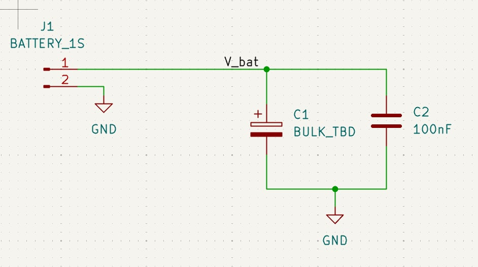
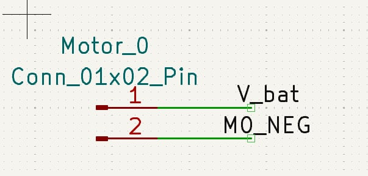
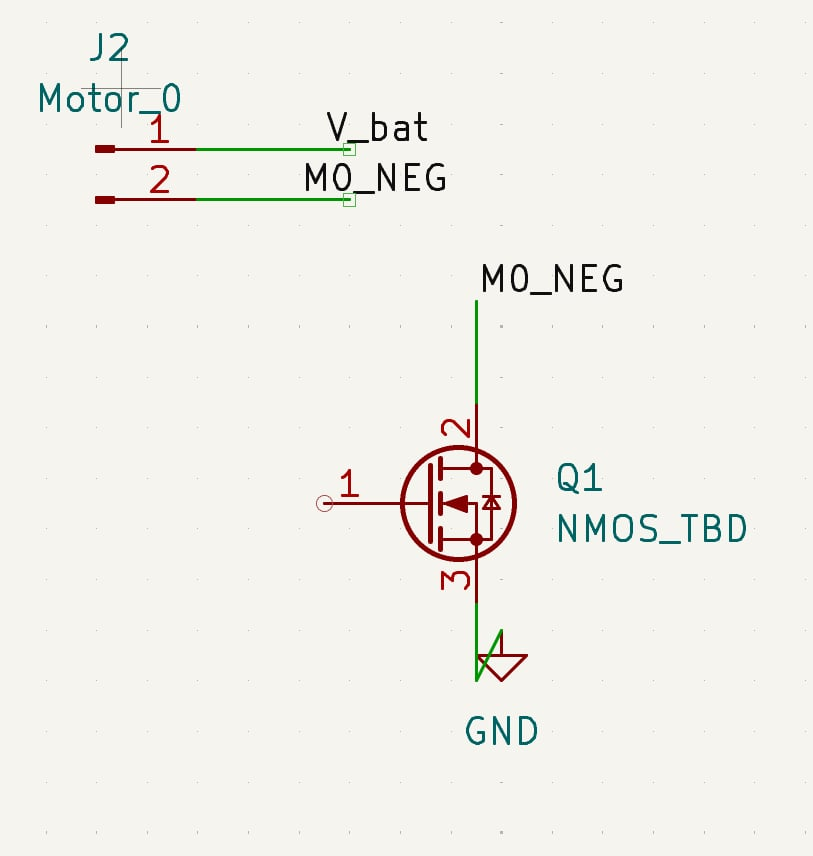
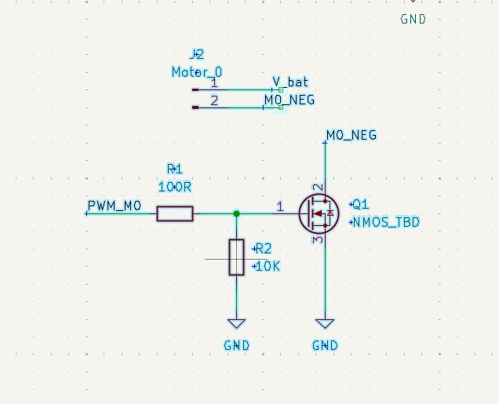
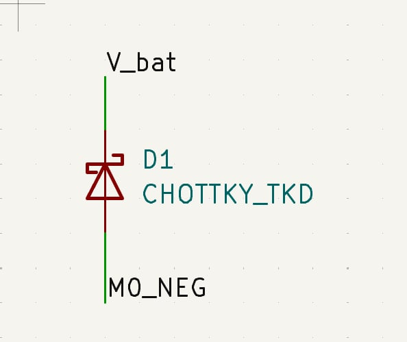
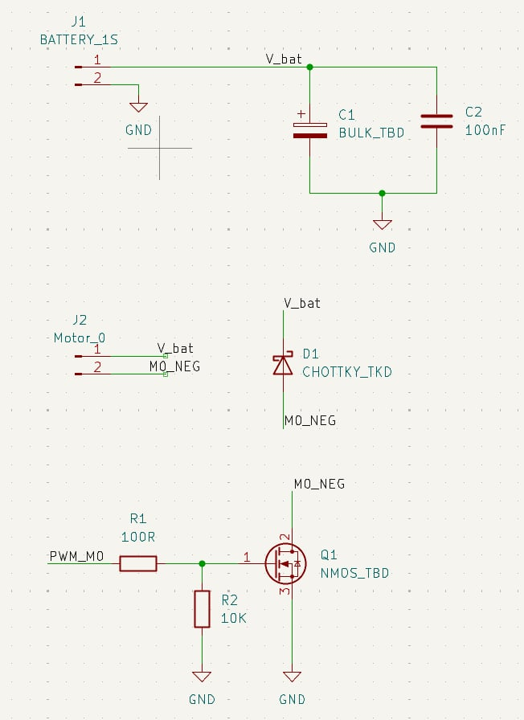
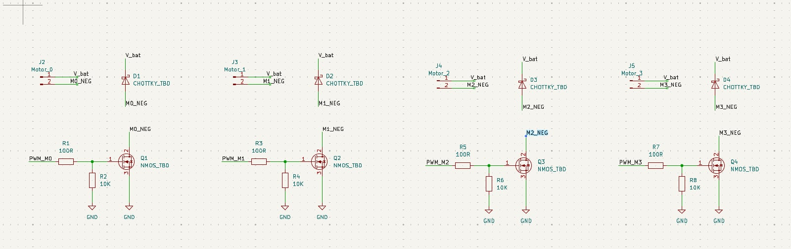
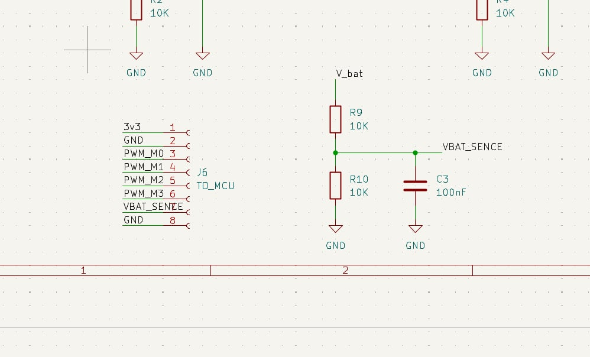

# UAV Mini — nền tảng drone học thuật chi phí thấp

**Mục tiêu:** phát triển kit học điều khiển từ Flix, có log, bài thực hành và hướng mở rộng ToF/optical flow. Crazyflie là mốc tham chiếu tính năng; chưa tuyên bố tương đương hoặc tương thích.

**Trạng thái 03/11/2026:** chưa mua phần cứng. Đã thêm bộ tích hợp firmware **chạy bàn, khóa đầu ra motor**, cấu hình ESP32-S3 đề xuất, công cụ phân tích log và ngân sách mục tiêu. Chưa có thử nghiệm bay hoặc PCB hoàn chỉnh để gia công.

| Bắt đầu ở đây | Nội dung |
|---|---|
| [Lộ trình kit học thuật](docs/ACADEMIC_PRODUCT_ROADMAP.md) | Core Lab → Research → nhiều drone, ngân sách và ticket |
| [Firmware chạy bàn](firmware/README.md) | Cách tải đúng upstream, build, cấu hình và giới hạn |
| [Kết quả kiểm tra](docs/VALIDATION.md) | Kiểm tra phần mềm đã chạy và phần chưa xác minh |
| [Nguồn và PCB Rev A](docs/REV_A_POWER_AND_PCB.md) | Nguồn, USB, linh kiện và kế hoạch KiCad |
| [Nguồn gốc và thương mại hóa](docs/COMMERCIALIZATION_NOTES.md) | Tình trạng giấy phép, phân phối và thương hiệu |

Chạy ngay trên máy tính tại thư mục repo (cần Python 3):

```bash
python3 tools/budget.py
python3 tools/analyze_log.py examples/synthetic_log.csv
```

Ví dụ CSV là dữ liệu tổng hợp, không phải kết quả bay. Phần dưới giữ lại bài học KiCad và cấu hình tham khảo trước khi chốt phần cứng.

## Học vẽ mạch điều khiển bằng KiCad

**ESP32-S3 SuperMini + 4 motor chổi than + IMU + ToF + optical flow**  
Cập nhật: 03/11/2026 • Project hiện tại: `Flix_power`

UAV Mini là dự án học thiết kế mạch cho drone nhỏ, tham khảo dự án mã nguồn mở [Flix](https://github.com/okalachev/flix). Mục tiêu là làm một PCB mang bốn kênh điều khiển động cơ và các cổng cảm biến, với bo ESP32-S3 SuperMini cắm lên trên.

**Tài liệu dành cho người mới chưa biết bắt đầu vẽ schematic từ đâu.** Bạn sẽ lần lượt vẽ đầu pin, một kênh motor, nhân thành bốn kênh, nối bo S3 và các cổng cảm biến, rồi kiểm tra kết nối bằng ERC.

Schematic là sơ đồ các linh kiện nối điện với nhau. PCB là bản bố trí linh kiện và đường đồng để gia công. Tài liệu này hướng dẫn phần schematic; chưa phải hướng dẫn hoàn chỉnh từ đầu đến một drone bay được.

> Dự án đang phát triển. Các giá trị có chữ TBD và phần nguồn S3 chưa được chốt. Bạn có thể dùng tài liệu để học vẽ, nhưng chưa dùng bản hiện tại để đặt PCB hoặc lắp cấp điện. Repository hiện có tài liệu và hình tham khảo, chưa có bộ file KiCad đã kiểm chứng.

Các ảnh chụp KiCad ở bài thực hành A–E là ảnh thật ghi lại từng bước vẽ của dự án. Chú thích ngay dưới ảnh chỉ rõ phần nào còn là bước trung gian hoặc thuộc phương án cũ. Bốn hình sơ đồ chức năng ở các mục tham khảo được vẽ riêng để giải thích kết nối.

## Bắt đầu từ đâu?

1. Cài KiCad, tạo **New Project** tên `Flix_power` trong một thư mục riêng.
2. Mở file `.kicad_sch` bằng Schematic Editor.
3. Đọc phần “Các khái niệm cần biết” bên dưới.
4. Làm lần lượt bài thực hành A–F; dùng bảng chân và hình ở các mục sau để đối chiếu.
5. Lưu file sau mỗi khối. Chạy ERC để tìm lỗi kết nối trước khi chuyển sang bố trí PCB.

### Các khái niệm cần biết

| Tên | Hiểu đơn giản |
|---|---|
| Symbol | Ký hiệu linh kiện trên schematic |
| Reference | Mã nhận diện riêng: J là đầu nối, R là điện trở, C là tụ, Q là transistor, D là diode |
| Value | Giá trị hoặc mã linh kiện, ví dụ 10k, 100nF |
| Wire | Dây thể hiện kết nối điện |
| Net label | Tên mạng điện; các dây có cùng local label trên cùng sheet nối điện với nhau dù không kéo dây dài |
| GND | Điểm tham chiếu chung của mạch |
| Footprint | Hình chân hàn và kích thước linh kiện trên PCB; chọn sau khi chốt linh kiện thật |
| ERC | Công cụ tìm một số lỗi kết nối trên schematic |
| TBD | Chưa chọn xong; đây không phải mã linh kiện để mua |

**Label phải có điểm neo chạm dây.** Chữ đặt gần dây chưa chắc đã nối điện. Số chân của connector cũng không phải số GPIO trên ESP32.

## Thao tác KiCad từng lệnh — đọc trước khi vẽ

Hướng dẫn dùng Schematic Editor trên Windows, với phím tắt mặc định. Khi bấm phím, đưa con trỏ vào vùng vẽ; nếu đang nhập chữ trong hộp thoại, phím sẽ nhập chữ thay vì chạy lệnh. Nếu đã đổi phím tắt, kiểm tra trong **Preferences → Preferences → Hotkeys**.

### 1. Tạo project và mở trang vẽ

1. Mở KiCad Project Manager.
2. Chọn **File → New Project**, chọn thư mục và nhập tên Flix_power.
3. Giữ tùy chọn tạo thư mục riêng cho project nếu hộp thoại có tùy chọn này, rồi lưu.
4. Trong danh sách file của project, mở **Flix_power.kicad_sch**. Đây là trang vẽ sơ đồ nguyên lý.
5. Nếu lần đầu KiCad hỏi thiết lập thư viện symbol, chọn thư viện mặc định được cài cùng KiCad.
6. Dùng lưới **50 mil** để đặt chân và dây. Cuộn bánh xe chuột để phóng to khu vực đang vẽ.

### 2. A — thêm linh kiện

Ví dụ thêm đầu pin J1:

1. Đưa chuột tới khoảng trống, nhấn **A**.
2. Trong cửa sổ Choose Symbol, gõ **Conn_01x02_Pin** vào ô tìm kiếm.
3. Chọn đúng kết quả, nhìn hình xem có hai chân đánh số 1 và 2, rồi bấm **OK**.
4. Symbol đi theo con trỏ. Di chuyển tới nơi muốn đặt, bấm chuột trái một lần.
5. Nhấn **Esc** để thoát chế độ đặt; nếu còn công cụ hoạt động, nhấn Esc thêm lần nữa.

Dùng cùng thao tác này cho từng linh kiện:

| Cần vẽ | Từ khóa tìm bằng A | Reference theo bài | Value nhập bằng E |
|---|---|---|---|
| Đầu pin | Conn_01x02_Pin | J1 | BATTERY_1S |
| Đầu motor | Conn_01x02_Pin | J2–J5 | Motor_0 đến Motor_3 |
| Tụ phân cực | Device:C_Polarized | C1 | BULK_TBD |
| Tụ không phân cực | Device:C | C2, C3 | 100nF |
| Điện trở | Device:R | R1–R10 | Theo bảng từng khối |
| MOSFET N | Q_NMOS_GDS | Q1–Q4 | NMOS_TBD |
| Diode Schottky | Device:D_Schottky | D1–D4 | SCHOTTKY_TBD |
| Socket S3 | Conn_01x09_Socket | J7, J8 | S3_LEFT, S3_RIGHT |
| Đầu ToF | Conn_01x04_Pin | J6 | TOF_I2C |
| Đầu IMU/flow | Conn_01x06_Pin | J9, J10 | IMU_SPI, FLOW_SPI |

Nếu không tìm thấy, bỏ phần tên thư viện trước dấu hai chấm và tìm lại. Không chọn đại linh kiện có chân khác. Pin/Socket trong tên symbol biểu diễn loại đầu nối; footprint thật và kích thước hàng chân vẫn cần chọn riêng.

### 3. E — sửa tên và giá trị

1. Nhấn Esc để thoát công cụ trước đó.
2. Rê chuột lên **thân symbol** J1, nhấn **E**. Nếu xuất hiện danh sách nhiều đối tượng, chọn symbol cần sửa.
3. Trong Symbol Properties, tìm hàng **Reference**, nhập J1.
4. Tìm hàng **Value**, nhập BATTERY_1S; bấm **OK**.
5. Kiểm tra trên trang vẽ có cả J1 và BATTERY_1S.

Với điện trở, nhập Value là 100R hoặc 10k theo bài. Reference phải duy nhất: R1 và R2 là hai linh kiện khác nhau. Chưa chốt linh kiện thật thì để trống Footprint; không chọn footprint tùy ý chỉ để đi tiếp.

### 4. R — xoay; M — di chuyển

- **Xoay:** rê chuột lên thân điện trở → nhấn **R** một lần để xoay 90°; nhấn thêm nếu cần. Khi symbol đang đi theo chuột lúc đặt, cũng dùng R rồi bấm trái để đặt.
- **Di chuyển:** rê chuột lên symbol → nhấn **M** → đưa đến vị trí mới → bấm trái.
- Sau khi di chuyển một linh kiện đã nối dây, kiểm tra lại các đầu dây. Có thể dùng **G** để kéo linh kiện cùng dây, nhưng vẫn cần xem lại kết nối.
- Nhấn **Esc** để hủy thao tác chưa đặt. Nhấn **Ctrl+Z** để hoàn tác thay đổi vừa thực hiện.

### 5. W — nối dây điện

Ví dụ nối chân 1 của J1 đến cực dương C1:

1. Đặt C1 ở bên phải J1, cực + hướng lên trên.
2. Rê chuột đúng **đầu ngoài chân 1** của J1, không đặt lên số 1 hay chữ J1.
3. Nhấn **W**; di chuyển chuột để kéo dây.
4. Bấm trái tại vị trí muốn tạo góc rẽ, rồi tiếp tục tới đầu chân + của C1.
5. Bấm trái đúng đầu chân C1 để hoàn thành kết nối. Nhấn Esc để thoát công cụ.
6. Nếu muốn kết thúc một đoạn dây ở khoảng trống để đặt label, **nhấp đúp** tại điểm cuối rồi Esc.

Dây là đối tượng Wire, không dùng đường đồ họa để thay dây điện. Đầu dây phải bắt đúng chân trên lưới.

**Tạo nhánh:** rê chuột lên dây có sẵn → W → kéo tới chân linh kiện khác → bấm trái. Tại điểm nhánh nối điện sẽ có junction; không coi hai đường nhìn như chạm nhau là bằng chứng đủ nếu chưa kiểm tra điểm nối.

### 6. L — đặt tên mạng điện

Ví dụ đặt nhãn V_bat lên dây từ J1.1:

1. Nhấn Esc để thoát lệnh vẽ dây.
2. Rê chuột gần đoạn dây, nhấn **L**.
3. Nhập đúng **V_bat** trong hộp thoại Label Properties → OK.
4. Nhãn đi theo chuột: đưa **điểm neo của nhãn** chạm đoạn dây, bấm trái để đặt.
5. Nhấn Esc. Muốn đổi tên, rê lên nhãn và nhấn E.

Làm tương tự với M0_NEG và PWM_M0. Không dùng **T (text)** để tạo tên mạng: chữ ghi chú không tạo kết nối điện. Các local label cùng tên trên cùng sheet thuộc cùng mạng; không tự suy ra kết nối qua các sheet khác nhau.

### 7. P — đặt GND

1. Rê chuột vào khoảng trống dưới linh kiện, nhấn **P**.
2. Tìm **GND**, chọn symbol power:GND → OK.
3. Đặt symbol dưới chân cần nối, bấm trái rồi Esc.
4. Rê đúng đầu chân linh kiện → W → kéo tới điểm nối phía trên symbol GND → bấm trái.
5. Tất cả symbol GND dùng chung mạng điện; không cần vẽ dây dài nối mọi ký hiệu GND với nhau.

Không đổi tên nguồn 5V thành 3V3 để hết cảnh báo. Label và ký hiệu nguồn không tạo ra điện áp vật lý.

### 8. Ctrl+D — nhân bản một khối

1. Nhấn Esc để không còn công cụ đang chạy.
2. Kéo một khung chọn **từ trái sang phải**, bao trọn linh kiện, dây và nhãn của một kênh motor.
3. Kiểm tra các đối tượng cần sao chép đều được chọn; không lấy cả khối pin nếu chỉ muốn nhân motor.
4. Nhấn **Ctrl+D**, đưa bản sao sang bên phải, bấm trái rồi Esc.
5. Sửa Reference của bản sao theo bảng mục 4 nếu cần; tránh trùng với bản gốc.
6. Rê lên từng nhãn → E: PWM_M0 thành PWM_M1, và **cả ba** M0_NEG thành M1_NEG.
7. Lặp lại cho kênh 2 và 3; giữ nguyên V_bat và GND.

Nhân bản không tự hiểu đâu là tín hiệu dùng chung, đâu là tín hiệu riêng. Nếu quên đổi M0_NEG, hai kênh sẽ bị nối chung qua tên mạng.

### 9. Delete, Ctrl+Z, Esc — sửa thao tác nhầm

- Rê lên đúng đối tượng cần bỏ → **Delete**. Nếu chọn nhầm, **Ctrl+Z** ngay.
- **Esc** hủy công cụ/selection hiện tại, không hoàn tác những gì đã đặt xong.
- Khi khó chọn dây vì gần chữ hoặc chân, phóng to và chọn đúng đối tượng trong danh sách KiCad hiện ra.
- Nếu đầu dây chưa bắt đúng chân, xóa đoạn sai rồi vẽ lại bằng W từ đầu chân. Không kéo chữ nhãn tới gần để che lỗi.

### 10. Lưu và chạy ERC

1. Nhấn **Ctrl+S**.
2. Chọn **Inspect → Electrical Rules Checker**.
3. Bấm **Run ERC**; hiển thị cả Errors và Warnings.
4. Nhấp đúp một dòng cảnh báo để KiCad đưa tới vị trí liên quan.
5. Sửa lỗi trên trang vẽ, lưu, chạy ERC lại. Đối chiếu xem đúng cảnh báo đó đã biến mất chưa.
6. Nếu Reference còn dạng R?/J? hoặc bị trùng, dùng **Tools → Annotate Schematic**; đọc lựa chọn trước khi áp dụng, giữ các Reference đã gán đúng. Khi số đổi, đối chiếu lại bảng hướng dẫn theo chức năng.

**Chỉ với chân thực sự không dùng:** bỏ dây/label thừa, rê đúng đầu chân rồi nhấn **Q** để đặt dấu No Connect. Không đánh Q lên chân cấp nguồn đang thiếu mạch nguồn. PWR_FLAG chỉ khai báo nguồn cho ERC, không thay thế mạch nguồn.

Thao tác tham khảo: [KiCad Schematic Editor 10.0](https://docs.kicad.org/10.0/en/eeschema/eeschema.html).

### Bài thực hành A — vẽ đầu pin

- Nhấn **A**, tìm `Conn_01x02_Pin`, đặt đầu nối J1; nhấn **E** đổi Value thành `BATTERY_1S`.
- Nhấn **W** từ chân 1, kéo một đoạn dây; nhấn **L** đặt nhãn `V_bat`.
- Nối chân 2 với ký hiệu GND bằng **P → GND**.
- Thêm tụ phân cực C1 và tụ không phân cực C2 song song giữa V_bat và GND, theo mục 5. Đặt C1 là `BULK_TBD`, C2 là `100nF`.
- Kiểm tra cực dương C1 nối V_bat. Đây là đầu vào pin, chưa phải mạch sạc.

**Thứ tự nối C1/C2 bằng W:**

1. A → Device:C_Polarized → đặt C1 → E → Value BULK_TBD. Xoay R nếu cần để cực + ở trên.
2. A → Device:C → đặt C2 bên phải C1 → E → Value 100nF.
3. W từ J1.1 tới chân + C1; W từ nút này sang chân trên C2.
4. W nối chân dưới C1 với chân dưới C2; đặt GND tại mạng này bằng P rồi nối W.
5. P → GND → đặt dưới J1.2; W nối J1.2 tới GND.
6. L → V_bat → đặt điểm neo lên dây J1.1. Ctrl+S.

**Ảnh chụp thực tế sau khi vẽ khối đầu pin:**



Hai ký hiệu GND thuộc cùng mạng điện. Chấm xanh tại chỗ rẽ thể hiện điểm nối dây. C1 vẫn chờ chọn giá trị thực tế.

### Bài thực hành B — vẽ một kênh motor

- Thêm đầu nối 2 chân J2, đổi Value thành `Motor_0`.
- Nối chân 1 tới nhãn `V_bat`, chân 2 tới `M0_NEG`.
- Thêm symbol `Q_NMOS_GDS` làm Q1 và hai điện trở R1, R2.
- Nối theo hình mục 4: PWM_M0 → R1 → Gate; R2 từ Gate xuống GND; Source xuống GND; Drain tới M0_NEG.
- Thêm diode Schottky D1: cathode tới V_bat, anode tới M0_NEG.
- Đặt giá trị tạm theo mục 4. Đối chiếu cả tên chân G/D/S và số chân trước khi nối.

#### B1. Đặt đầu nối motor

Nhấn **A** để thêm đầu nối 2 chân, **E** sửa Value thành Motor_0. Dùng **W** vẽ dây và **L** đặt V_bat/M0_NEG. Đặt Reference là J2; chữ Motor_0 là Value, không thay cho Reference.



#### B2. Thêm MOSFET

Nhấn **A**, tìm Q_NMOS_GDS. Đặt Drain lên trên, Source xuống dưới như ảnh; rê chuột lên symbol và nhấn **R** nếu cần xoay. Nối Drain tới M0_NEG, Source tới GND. Chân Gate bên trái sẽ nối ở bước B3.



Ảnh này là bước trung gian: Gate còn hở. Vẽ dây GND gọn, tránh đoạn dây gấp ngược như trong ảnh. Không cần kéo dây dài từ motor tới Drain: hai nhãn M0_NEG cùng sheet tạo kết nối.

#### B3. Thêm điện trở điều khiển Gate

Nhấn **A**, tìm symbol điện trở R và đặt R1 nằm ngang; dùng **R** để xoay. Nhấn **E** đặt Value 100R. Thêm R2 đứng dọc, Value 10k, nối từ nút giữa R1 và Gate xuống GND. Đầu còn lại của R1 đặt nhãn PWM_M0.



Đối chiếu chấm nối xanh ở nhánh R2: nhánh này phải nối vào phía Gate của R1.

#### B4. Thêm diode hồi dòng

Nhấn **A**, tìm symbol D_Schottky. Xoay để cathode (đầu có vạch gấp của ký hiệu Schottky) ở phía V_bat; anode nối M0_NEG. Đặt Reference D1 và Value SCHOTTKY_TBD trong giai đoạn chưa chọn mã thật.



Ảnh cũ ghi CHOTTKY_TKD; dùng tên SCHOTTKY_TBD trong bài vẽ. Đây là giá trị tạm, không phải mã linh kiện.

#### B5. Đối chiếu cả kênh



Theo dõi ba điểm mang nhãn M0_NEG: đầu motor, diode và Drain. Cả ba phải viết cùng một tên. Gate phải có cả điện trở nối tiếp và điện trở kéo xuống.

### Bài thực hành C — tạo đủ bốn kênh

Nhân bản khối motor ba lần. Dùng bảng mục 4 để sửa Reference và tên nhãn từng kênh. Cả bốn kênh dùng chung V_bat và GND; mỗi kênh phải có PWM và Mn_NEG riêng. Khi KiCad tự đánh số khác bảng, có thể sửa Reference để thống nhất; tuyệt đối không để hai linh kiện trùng Reference.

**Kết quả bố trí bốn kênh trong KiCad:**



Chọn cả khối một kênh rồi nhân bản bằng **Ctrl+D**. Sửa nhãn kênh 1, 2, 3 ngay sau mỗi lần nhân; bảng mục 4 liệt kê tên cần dùng. Giữ V_bat/GND chung cho tất cả kênh.

### Bài thực hành D — socket S3 và đo pin

- Thêm hai socket 9 chân làm J7/J8. Đây là chỗ cắm bo S3 lên PCB.
- Kéo dây ngắn và đặt nhãn từng chân theo bảng mục 3.
- Vẽ R9, R10 và C3 theo mục 5; nối điểm giữa tới `VBAT_SENSE`.
- Phân biệt rõ J8.1 là `S3_5V`, J8.3 là `S3_3V3`. Phần tạo nguồn cấp S3 vẫn chờ hoàn thiện ở mục 7.

**Thao tác vẽ hai socket:**

1. A → Conn_01x09_Socket → đặt J7 → E sửa Value S3_LEFT.
2. A → Conn_01x09_Socket → đặt J8 → E sửa Value S3_RIGHT.
3. Nếu chiều chân không giống ảnh, vẫn nhận diện theo số chân; dùng R để xoay nếu cần. Không lấy vị trí trên/dưới thay cho số chân.
4. Tại mỗi đầu chân: W → kéo đoạn dây ngắn → nhấp đúp kết thúc → Esc.
5. L → nhập tên nhãn trong bảng mục 3 → đặt điểm neo lên đoạn dây đó → Esc.
6. Riêng chân J8.2, đặt GND bằng P và nối W.
7. Kiểm tra lần lượt chân 1 đến 9 của cả hai socket trước khi lưu.

**Ảnh quá trình vẽ mạch đo pin — chỉ làm theo khối bên phải:**



Nhấn **A** đặt hai điện trở, dùng **R** xoay đứng, **E** đặt mỗi con 10k. Nối R9 từ V_bat tới nút giữa, R10 từ nút giữa xuống GND. Thêm C3 100nF từ nút giữa xuống GND, rồi đặt nhãn VBAT_SENSE tại nút giữa.

**Đầu J6 TO_MCU bên trái thuộc phương án cũ, không vẽ lại.** Thiết kế hiện tại dùng J7/J8 cắm trực tiếp S3; J6 được dùng làm cổng ToF. Dùng bảng chân mục 3 để vẽ hai socket S3.

### Bài thực hành E — cổng cảm biến

Thêm đầu nối 4 chân J6 cho ToF, đầu nối 6 chân J9 cho IMU và J10 cho optical flow. Gắn nhãn theo bảng mục 6. Các đầu nối này chỉ đại diện cổng trên PCB; khi dùng module thật phải đối chiếu thứ tự chân module trước khi làm dây.

**Thao tác cho từng cổng:**

1. A → Conn_01x04_Pin → đặt → E sửa Reference J6 và Value TOF_I2C.
2. W vẽ đoạn dây ngắn từ mỗi chân; kết thúc đoạn bằng nhấp đúp rồi Esc.
3. L đặt nhãn: chân 1 S3_3V3, chân 3 I2C_SDA, chân 4 I2C_SCL; chân 2 nối GND bằng P/W.
4. A → Conn_01x06_Pin → đặt → E sửa Reference J9, Value IMU_SPI.
5. Vẽ dây và nhãn cho sáu chân J9 theo bảng mục 6, đặc biệt chân 6 IMU_CS.
6. Chọn cả khối J9 → Ctrl+D → đặt bản sao → E sửa Reference J10, Value FLOW_SPI.
7. Rê nhãn chân 6 trên bản sao → E → đổi IMU_CS thành FLOW_CS. Các chân 1–5 giữ theo bảng.
8. Ctrl+S và chạy ERC.

Ảnh tổng thể dưới đây cho thấy các đầu nối nằm ở phía trên của sơ đồ:


Đây là ảnh trong quá trình vẽ, **còn lỗi nhãn J8.1**: khi thực hành phải đặt J8.1 = S3_5V, J8.3 = S3_3V3. Dùng bảng mục 3 và mục 6 để đối chiếu, không sao chép nguyên mọi nhãn trong ảnh. J9.6 phải là IMU_CS, J10.6 phải là FLOW_CS.

### Bài thực hành F — tự kiểm tra

Lưu sơ đồ, chạy ERC theo mục 8. Nhấp đúp từng cảnh báo để tìm vị trí, sửa kết nối rồi chạy lại. Đối chiếu bảng chân bằng mắt ngay cả khi ERC hết lỗi. Hoàn thành bài thực hành nghĩa là đã dựng được các khối schematic; phần nguồn, chọn linh kiện và layout vẫn cần các bước tiếp theo.

## 1. Kiến trúc dự án — một PCB

Bo S3 SuperMini cắm trực tiếp lên **J7/J8**. Bốn kênh công suất, đầu pin, đo pin, cổng IMU, ToF và optical flow nằm trên cùng PCB. Thiết kế dùng một PCB mang bo S3 và các đầu nối.

Mục tiêu phần mềm là dùng camera ngoài và máy tính để ước lượng vị trí, gửi dữ liệu hoặc lệnh qua Wi-Fi. S3 đọc cảm biến và điều khiển tư thế trên drone. ToF đo khoảng cách sàn; optical flow hỗ trợ ước lượng chuyển động ngang. Cần phát triển phần mềm kết hợp cảm biến và điều khiển vị trí, không chỉ cắm đủ phần cứng.


**Số đầu nối dùng thống nhất trong toàn tài liệu:**

| Reference | Chức năng | Symbol đang dùng / dự kiến |
|---|---|---|
| J1 | Pin LiPo 1S | Conn_01x02_Pin |
| J2–J5 | Motor 0–3 | Conn_01x02_Pin |
| J6 | TOF_I2C, 4 chân | Conn_01x04_Pin |
| J7 | S3_LEFT, 9 chân | Conn_01x09_Socket |
| J8 | S3_RIGHT, 9 chân | Conn_01x09_Socket |
| J9 | IMU_SPI, 6 chân | Conn_01x06_Pin |
| J10 | FLOW_SPI, 6 chân | Conn_01x06_Pin |

## 2. Phạm vi hiện tại

| Đã có trong hướng dẫn | Còn phải hoàn thiện |
|---|---|
| Cách vẽ đầu pin và bốn kênh motor | Chọn mã MOSFET, diode và tụ bulk |
| Bảng kết nối S3 và cổng cảm biến | Xác minh đúng phiên bản bo và module thực tế |
| Mạch chia áp đo pin | Nguồn S3, ngân sách dòng và xử lý nguồn USB |
| Quy trình kiểm tra ERC | File KiCad kiểm chứng, footprint, layout và DRC |

Các kết nối trong tài liệu là phương án thiết kế đang phát triển. Chưa có kết quả thử phần cứng hoặc thử bay của PCB này.

## 3. Socket S3 — bảng chân chuẩn của thiết kế

Nhìn mặt linh kiện bo S3, USB hướng lên. Chân socket 1–9 là số tự quy ước từ trên xuống, **không phải số GPIO**. Bảng lấy theo ảnh pinout người dùng cung cấp; cần kiểm tra với đúng bo mua thực tế trước khi làm footprint.


| Chân | J7 — chân S3 | Nhãn J7 | J8 — chân S3 | Nhãn J8 |
|---|---|---|---|---|
| 1 | TX | S3_TX | 5V | **S3_5V** |
| 2 | RX | S3_RX | GND | GND |
| 3 | GPIO1 | VBAT_SENSE | 3V3 | **S3_3V3** |
| 4 | GPIO2 | FLOW_CS | GPIO13 | SPI_MISO |
| 5 | GPIO3 | S3_GPIO3 | GPIO12 | SPI_SCK |
| 6 | GPIO4 | PWM_M0 | GPIO11 | SPI_MOSI |
| 7 | GPIO5 | PWM_M1 | GPIO10 | IMU_CS |
| 8 | GPIO6 | PWM_M2 | GPIO9 | I2C_SCL |
| 9 | GPIO7 | PWM_M3 | GPIO8 | I2C_SDA |

### Cách đặt dây và nhãn trong KiCad

1. Rê chuột lên nhãn, nhấn **E**, nhập đúng tên trong bảng.
2. Nếu chưa có dây: rê đúng đầu chân, nhấn **W**, kéo đoạn dây rồi Esc.
3. Nhấn **L** đặt nhãn; điểm neo phải chạm dây.
4. Với GND, dùng **P → GND**, nối đầu chân ký hiệu vào dây.

**S3_5V và S3_3V3 là hai mạng khác nhau. Không nối chung, không đổi tên để hết cảnh báo.** S3_TX/RX và GPIO3 đang dự phòng; chưa xác minh số GPIO của TX/RX. GPIO3 là chân strapping, tránh gán tải tùy ý. USB dùng GPIO19/20 trên chip.

## 4. Bốn kênh motor


Hình dùng khối Q1 để chỉ G/D/S rõ ràng; trong KiCad dùng symbol MOSFET. Symbol minh họa có **G=1, D=2, S=3**, tương ứng kiểu `Q_NMOS_GDS`. Khi chọn linh kiện thật phải đối chiếu lại datasheet, không mặc định mọi MOSFET đều có số chân này.

### Kết nối của từng kênh

- Đầu motor chân 1 → `V_bat`; chân 2 → `Mn_NEG`.
- Drain MOSFET → `Mn_NEG`; Source → GND.
- `PWM_Mn` → điện trở nối tiếp Gate → Gate.
- Điện trở kéo xuống nối **từ Gate phía sau điện trở nối tiếp** xuống GND.
- Diode hồi dòng: **K/cathode → V_bat**, **A/anode → Mn_NEG**. Không mắc diode xuống GND.

| Motor | Đầu nối | MOSFET | Diode | R Gate | R kéo xuống | PWM | Đầu âm motor |
|---|---|---|---|---|---|---|---|
| 0 | J2 | Q1 | D1 | R1 | R2 | PWM_M0 | M0_NEG |
| 1 | J3 | Q2 | D2 | R3 | R4 | PWM_M1 | M1_NEG |
| 2 | J4 | Q3 | D3 | R5 | R6 | PWM_M2 | M2_NEG |
| 3 | J5 | Q4 | D4 | R7 | R8 | PWM_M3 | M3_NEG |

Giá trị ban đầu: R Gate **100R**, R kéo xuống **10k**. Giá trị 100R chưa chốt; phải xét GPIO, điện tích cổng, tổn hao chuyển mạch và tần số PWM. Q1–Q4 đang `NMOS_TBD`; D1–D4 đang `SCHOTTKY_TBD`. Sửa lỗi chữ `CHOTTKY...` nếu còn, nhưng chưa coi đây là mã để mua.

Khi nhân kênh, đổi đủ ba nhãn Mn_NEG tại đầu motor, diode và Drain. Không được để cùng nhãn NEG giữa các motor.

## 5. Đầu pin và đo điện áp

### Đầu pin

- J1.1 → `V_bat`; J1.2 → GND.
- C1 phân cực: cực + → V_bat, cực còn lại → GND. Value `BULK_TBD` chờ chọn.
- C2 = 100nF, song song C1.

### Chia áp

```text
             V_bat
               │
            R9 10k
               │
               ├──────── VBAT_SENSE ── J7.3 / GPIO1
               │               │
           R10 10k          C3 100nF
               │               │
              GND             GND
```

Hai điện trở bằng nhau cho `VBAT_SENSE = V_bat / 2`: pin 4,2 V → 2,1 V ở ADC. Dự kiến dùng điện trở 1%, cấu hình attenuation ADC phù hợp và hiệu chuẩn phần mềm. Mạch này không sạc hoặc bảo vệ pin. Cần kiểm tra tình huống pin còn nối nhưng S3 mất nguồn để tránh cấp điện ngoài ý muốn qua chân ADC.

Nhãn chuẩn là **VBAT_SENSE**, không phải `VBAT_SENCE`. KiCad coi hai tên này là hai mạng khác nhau.

## 6. Cổng IMU, ToF và optical flow


**Đây là cổng nối dây do thiết kế quy ước. Không cắm module theo số chân bên dưới nếu chưa đối chiếu chân thực tế của module.** Dùng module có nguồn/logic tương thích 3,3 V hoặc bổ sung chuyển mức phù hợp. Không cấp chip cảm biến trần theo pinout module.

| Chân | J6 — TOF_I2C | J9 — IMU_SPI | J10 — FLOW_SPI |
|---|---|---|---|
| 1 | S3_3V3 | S3_3V3 | S3_3V3 |
| 2 | GND | GND | GND |
| 3 | I2C_SDA | SPI_SCK | SPI_SCK |
| 4 | I2C_SCL | SPI_MOSI | SPI_MOSI |
| 5 | — | SPI_MISO | SPI_MISO |
| 6 | — | **IMU_CS** | **FLOW_CS** |

### I²C — ToF

GPIO8/J8.9 = SDA; GPIO9/J8.8 = SCL. Kiểm tra điện trở kéo lên có sẵn trên module, điện áp được kéo lên và tải bus trước khi chọn điện trở bổ sung. Không tự cộng thêm 4,7k theo thói quen nếu module đã có pull-up. Xem yêu cầu XSHUT/INT theo module và cách sử dụng.

ToF gắn nhìn xuống sàn, không bị pin/khung che; dây ngắn và cố định chắc. Khoảng cách đo cần hiệu chỉnh theo tư thế để suy ra độ cao. Giới hạn đo tùy module, bề mặt và ánh sáng.

### SPI — IMU và optical flow

Chung GPIO12 SCK, GPIO11 MOSI, GPIO13 MISO. **IMU_CS = GPIO10**, **FLOW_CS = GPIO2**. Hai CS phải tách riêng. Kiểm tra mức deselect lúc khởi động và pull-up CS theo module thực tế.

Dự kiến optical flow PMW3901 dạng module SPI; IMU dạng module mà Flix hỗ trợ, ví dụ GY-91 sau khi xác nhận chip thực tế. Không đổi sang module chỉ có I²C mà giữ nguyên cổng SPI này.

Phương án hiện tại không dành chân INT riêng cho IMU/flow; cần xác nhận driver hỗ trợ polling. Phần mềm quản lý mode/tốc độ SPI theo thiết bị và lịch đọc để optical flow không làm trễ vòng IMU. Cần đo tải tổng trước khi dùng nguồn 3V3 của bo S3 cấp tất cả module.

## 7. Phần nguồn — đặc tả Rev A

Đã bổ sung [đặc tả nguồn, ngân sách dòng, ma trận thử và kế hoạch triển khai PCB](docs/REV_A_POWER_AND_PCB.md). Đây là tài liệu thiết kế, chưa phải schematic hoặc PCB đã kiểm chứng.

**Phương án thử ưu tiên:** LiPo 1S cấp trực tiếp bốn motor; nhánh logic dùng boost 5 V, qua khối chọn nguồn/chặn ngược, tới S3_5V; ổn áp trên SuperMini tạo 3,3 V. Việc dùng rail này cho cảm biến phụ thuộc khả năng dòng và nhiệt thực tế.

**Điểm chặn bắt buộc:** xác minh VBUS USB có nối cứng với S3_5V hay không. Mux trên PCB mẹ không giải quyết được đường nối đi vòng trên bo SuperMini. Cần cách ly đúng vị trí hoặc chọn nguồn bằng phần cứng đã kiểm chứng. USB chỉ cấp logic/debug, không cấp motor và không sạc pin qua boost.

| Kiến trúc | Đánh giá |
|---|---|
| 1S → boost 5 V → ổn áp SuperMini | Thuận tiện thử; phải kiểm tra tổn hao LDO và USB |
| 1S → buck-boost 3,3 V | Hướng tối ưu; phải xử lý ổn áp có sẵn và USB trước khi cấp vào 3V3 |
| 1S → LDO/buck 3,3 V | Mất điều áp khi pin thấp; không ưu tiên toàn dải xả |
| 1S → boost 3,3 V | Không bảo đảm hạ pin đầy xuống 3,3 V |
| 1S → trực tiếp 3V3 | Không được phép |

Espressif khuyến nghị nguồn 3,3 V có năng lực ít nhất 500 mA cho S3; đây không phải dòng tiêu thụ cố định. Cần cộng tải cảm biến, tải phụ, xung RF và dự phòng. Ví dụ giả định 600 mA liên tục qua LDO 5 V → 3,3 V gây khoảng 1,02 W tổn hao: chưa thể khẳng định ổn áp trên SuperMini chịu được.

TPS61023 (boost), TPS63070/TPS63031 (buck-boost), TPS2116 (mux) chỉ là ứng viên khảo sát, chưa duyệt BOM. Không nhầm giới hạn dòng công tắc với dòng đầu ra.

Trước khi chốt schematic cần mã/revision SuperMini, motor và cánh, pin, module cảm biến, module nguồn và kích thước PCB. Các mã MOSFET/Schottky/tụ bulk vẫn TBD. Không nối LiPo 4,2 V trực tiếp vào 3V3, không nối S3_5V với S3_3V3.

## 8. Khắc phục và chạy lại ERC

ERC giúp tìm các điểm nối còn thiếu hoặc cách khai báo chân chưa phù hợp. Những cảnh báo thường gặp khi làm bài này:

| Cảnh báo | Cách xử lý |
|---|---|
| Unconnected wire endpoint | Kiểm tra đầu dây và điểm neo nhãn; vẽ lại đoạn dây nếu chưa chạm |
| Local and global labels have same name | Với GND, thống nhất dùng symbol power:GND |
| Label connected to only one pin | Kiểm tra xem thiếu kết nối hay chân được chủ ý để dự phòng; nguồn S3 chưa hoàn thiện cũng cần kiểm tra |

### Quy trình

1. **Ctrl+S → Inspect → Electrical Rules Checker → Run ERC**.
2. Bật cả Errors và Warnings; xuất báo cáo mới.
3. Với đầu dây hở: phóng to, bắt đầu **W** đúng đầu chân; đặt điểm neo nhãn lên dây, không chỉ đặt chữ gần dây.
4. Với chân thực sự không dùng: chỉ đặt No Connect trực tiếp chân sau khi quyết định không dùng và gỡ dây/nhãn thừa. Không làm vậy với S3_5V đang chờ nguồn.
5. Chỉ thêm PWR_FLAG tại mạng thực sự được cấp nguồn khi ERC cần khai báo; cờ này không tạo ra nguồn điện.
6. Nếu dùng sheet con, kiểm tra kết nối giữa các sheet. Sheet con không tự tạo PCB thứ hai.
7. Bật lại kiểm tra footprint filter đang bị bỏ qua khi chốt footprint. Ghi lý do cho mọi cảnh báo cố ý giữ lại.

**ERC không phát hiện mọi lỗi:** chân connector passive có thể không báo thiếu nguồn; nhãn sai nhưng có kết nối vẫn có thể qua kiểm tra; chọn sai MOSFET hoặc điện áp module cũng không được đảm bảo bởi ERC.

## 9. Danh sách cần chốt để hoàn thành schematic

| Hạng mục | Cần xác định | Trạng thái |
|---|---|---|
| S3 SuperMini | Đúng bo/revision, schematic nguồn, kích thước hàng chân | Chờ |
| Q1–Q4 | Mã MOSFET, pinout, RDS(on) ở mức Gate phù hợp, Qg, nhiệt | Chờ |
| D1–D4 | Mã Schottky, dòng hồi tiếp, áp ngược, nhiệt, pinout | Chờ |
| C1 | Dung lượng, ESR, điện áp, kích thước | Chờ |
| R Gate | Xác nhận 100R theo linh kiện, GPIO và PWM | Tạm |
| Module nguồn | Mã, pinout, công suất và đường USB/cấp ngoài | Chờ |
| IMU | Mã module/chip, SPI, nguồn, hướng trục | Chờ |
| ToF | Mã module, nguồn/logic, pull-up, tầm đo | Chờ |
| Optical flow | Mã module SPI, nguồn, RESET/IRQ, chiều trục | Chờ |
| Header/motor/pin | Dòng, bước chân, cực tính và khóa cơ khí | Chờ |

### Điều kiện chuyển sang layout

- [ ] Tất cả mạng S3 đối chiếu đúng bảng chân và đúng bo thực tế.
- [ ] S3_5V/S3_3V3 tách biệt; đường cấp nguồn hoàn chỉnh.
- [ ] Đúng CS riêng, đúng SDA/SCL, VBAT_SENSE thống nhất.
- [ ] Mọi TBD đã thay bằng mã/giá trị xác định; symbol khớp pinout.
- [ ] Module và nguồn logic tương thích, đã tính dòng và tình huống khởi động/mất nguồn.
- [ ] ERC mới được xem đầy đủ; lỗi sửa xong, cảnh báo còn lại có giải thích.
- [ ] Footprint đã kiểm tra số pad, góc nhìn và kích thước thực tế.
- [ ] Bố trí sơ bộ có chỗ anten, lỗ bắt vít, dây motor và cửa nhìn cảm biến.

Sau đó mới layout, DRC, kiểm tra 3D, xuất Gerber/BOM. Cần tính khối lượng bo + socket + module + dây so với sức nâng motor 8520. Thử nguồn và từng motor khi tháo cánh trước khi thử điều khiển bay.

## 10. Phím nhanh

| Phím | Thao tác |
|---|---|
| A | Thêm symbol |
| E | Sửa thuộc tính dưới con trỏ |
| W | Vẽ dây từ đầu chân |
| L | Thêm nhãn mạng |
| P | Thêm nguồn/GND |
| R | Xoay 90 độ |
| Ctrl+D | Nhân bản; nhớ đổi Reference và nhãn riêng từng kênh |
| Esc | Thoát thao tác |
| Ctrl+S | Lưu |

Khi cần người khác kiểm tra, gửi file `.kicad_sch` cùng các sheet con, báo cáo ERC và mã module thực tế. Ảnh chụp giúp xem bố cục nhưng không xác nhận đầy đủ các kết nối.

## Nguồn và hình minh họa

### Ảnh schematic và bo S3 tham khảo

Ảnh dưới là **ảnh chụp schematic thật trong KiCad**, trước lần sửa nhãn nguồn cuối. Nó vẫn thể hiện lỗi J8.1 mang S3_3V3 và các dấu ERC cũ; **không sao chép lỗi này**. Bảng chân ở mục 3 là hướng dẫn hiện hành: J8.1 = S3_5V, J8.3 = S3_3V3. Ảnh này chỉ để nhận biết bố cục các khối, không phải sơ đồ hoàn thiện để sao chép.


Ảnh pinout S3 bên dưới do người dùng cung cấp; nguồn xuất bản gốc chưa xác định. Dùng để đối chiếu hình dạng và hàng chân, không thay thế schematic/datasheet đúng phiên bản bo. Chưa có ảnh PCB tự thiết kế đã gia công hoặc drone đã lắp hoàn chỉnh.


- [Flix — danh sách linh kiện và kết nối gốc](https://github.com/okalachev/flix#components)
- [Espressif — GPIO ESP32-S3](https://docs.espressif.com/projects/esp-idf/en/v5.0/esp32s3/api-reference/peripherals/gpio.html)
- [Bitcraze — Flow breakout, SPI và I²C](https://www.bitcraze.io/products/flow-breakout/)
- [Bitcraze — driver PMW3901](https://github.com/bitcraze/Bitcraze_PMW3901)

Bốn hình PNG trong thư mục `images/` được dựng riêng cho hướng dẫn này. Bảng socket S3 dựa trên ảnh pinout người dùng cung cấp; không phải tài liệu chứng nhận của nhà sản xuất bo.

## Video học thêm

- [Electrical Rules Check trên KiCad — einstem](https://www.youtube.com/watch?v=UgQMZtF_Wkw&t=27s): phần chạy ERC bắt đầu ở 0:27.
- [ERC và DRC trên KiCad 9 cho người mới](https://www.youtube.com/watch?v=OZhVRyuPJuA): xem phần ERC khi đang vẽ schematic, phần DRC khi làm PCB.
- [KiCad — Getting Started](https://docs.kicad.org/9.0/en/getting_started_in_kicad/getting_started_in_kicad.html): tài liệu chính thức về quy trình thiết kế.

## Đóng góp

Có thể mở Issue trong repository để hỏi về bước vẽ hoặc báo lỗi tài liệu. Khi báo lỗi, ghi phiên bản KiCad, bước đang làm và kèm ảnh hoặc file schematic liên quan. Không coi việc hoàn thành bài vẽ hoặc ERC hết lỗi là xác nhận drone đã sẵn sàng bay.
