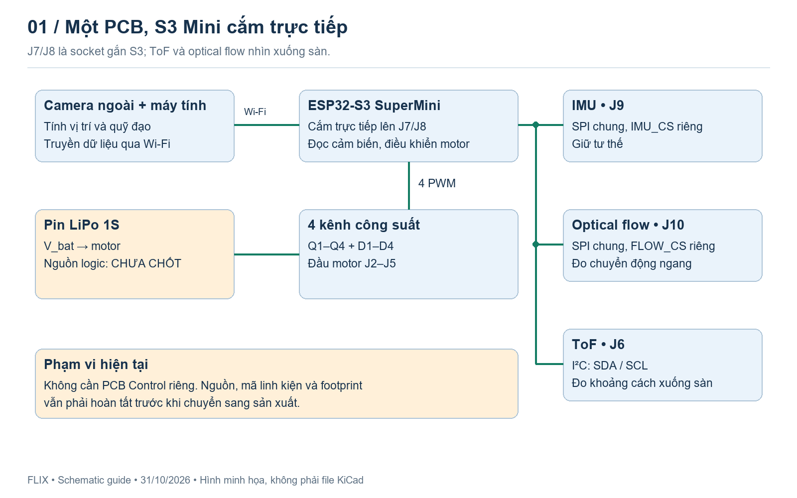
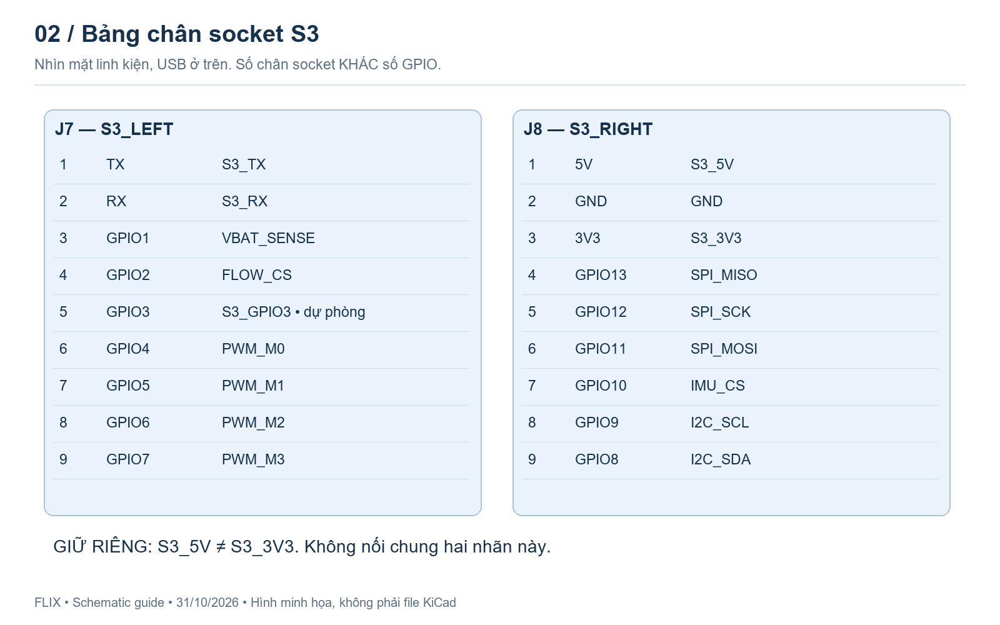
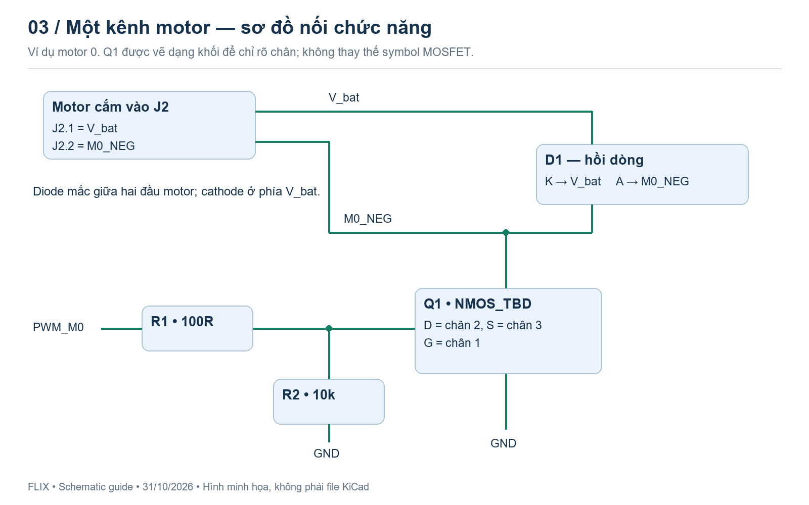
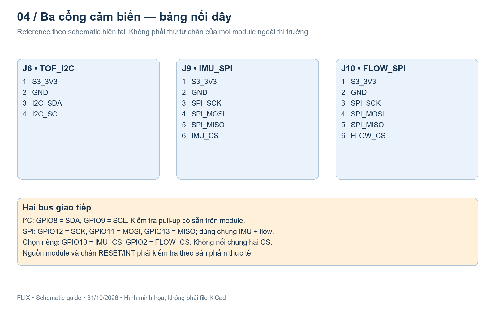
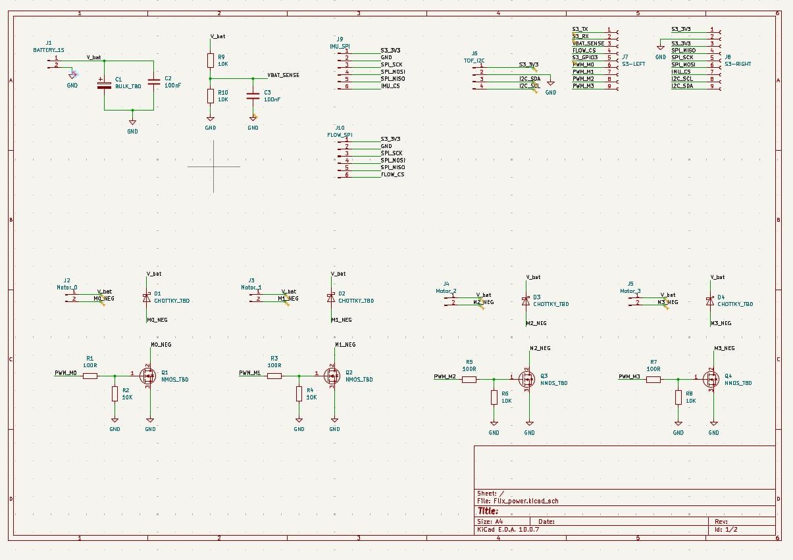
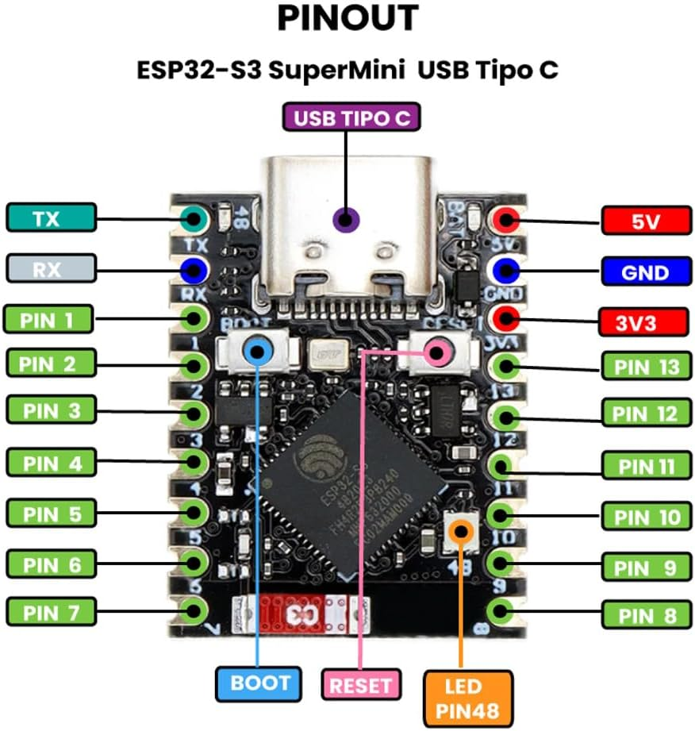

# Flix — hướng dẫn hoàn thiện schematic một PCB

**ESP32-S3 SuperMini + 4 motor chổi than + IMU + ToF + optical flow**  
Cập nhật: 31/10/2026 • Project hiện tại: `Flix_power`

> Đây là hướng dẫn đối chiếu và hoàn thiện schematic, chưa phải thiết kế đã kiểm chứng để đặt sản xuất. Các hình minh họa thể hiện kết nối chức năng, không phải ảnh xuất từ file KiCad. Chưa có file `.kicad_sch` để kiểm tra netlist; kết quả hiện tại dựa trên ảnh và báo cáo ERC người dùng gửi.

## 1. Phương án cuối cùng — giữ một PCB

Bo S3 SuperMini cắm trực tiếp lên **J7/J8**. Bốn kênh công suất, đầu pin, đo pin, cổng IMU, ToF và optical flow nằm trên cùng PCB. Không tạo PCB `Flix_Control` riêng và không chuyển J7/J8 sang project khác.

Camera ngoài và máy tính cung cấp vị trí/quỹ đạo qua Wi-Fi. S3 đọc cảm biến và điều khiển tư thế trên drone. ToF đo khoảng cách sàn; optical flow hỗ trợ ước lượng chuyển động ngang. Cần phát triển phần mềm kết hợp cảm biến và điều khiển vị trí, không chỉ cắm đủ phần cứng.



**Số đầu nối dùng thống nhất trong toàn tài liệu:**

| Reference | Chức năng | Symbol đang dùng / dự kiến |
|---|---|---|
| J1 | Pin LiPo 1S | Conn_01x02_Pin |
| J2–J5 | Motor 0–3 | Conn_01x02_Pin |
| J6 | TOF_I2C, 4 chân | Conn_01x04_Pin |
| J7 | S3_LEFT, 9 chân | Conn_01x09_Socket |
| J8 | S3_RIGHT, 9 chân | Conn_01x09_Socket |
| J9 | IMU_SPI, 6 chân | Conn_01x06_Pin |
| J10 | FLOW_SPI, 6 chân | Conn_01x06_Pin |

J6 hiện là ToF, **không phải TO_MCU cũ**. Không xóa J6 hiện tại. Các hướng dẫn cũ về J9 ToF hoặc J11 IMU không còn áp dụng.

## 2. Hiện trạng và việc làm ngay

| Phần | Trạng thái |
|---|---|
| Đầu pin, bốn kênh motor, chia áp đo pin | Đã vẽ; đã xem ảnh |
| Socket S3 và ba cổng cảm biến | Đã vẽ; đã hướng dẫn sửa nhãn |
| FLOW_CS, SDA/SCL, VBAT_SENSE | Đã sửa theo phản hồi/ảnh; cần kiểm tra lại bằng file |
| J8.1 từng bị gán nhầm S3_3V3 | Người dùng báo đã sửa về S3_5V; chưa có ERC mới |
| Nguồn cấp S3 | Chưa hoàn thiện |
| Mã MOSFET, diode, tụ bulk và module cảm biến | Chưa chốt |
| Kiểm tra ERC đầy đủ | Chưa hoàn tất; báo cáo cũ có 17 cảnh báo |
| Footprint, layout, DRC | Chưa thực hiện |

**Bước ngay tiếp theo:** lưu schematic, chạy ERC mới có cả Errors và Warnings; kiểm tra lại nguồn J8.1/J8.3. Sau đó chốt module nguồn và cảm biến trước khi điền linh kiện phụ hoặc footprint.

## 3. Socket S3 — bảng chân chuẩn của thiết kế

Nhìn mặt linh kiện bo S3, USB hướng lên. Chân socket 1–9 là số tự quy ước từ trên xuống, **không phải số GPIO**. Bảng lấy theo ảnh pinout người dùng cung cấp; cần kiểm tra với đúng bo mua thực tế trước khi làm footprint.



| Chân | J7 — chân S3 | Nhãn J7 | J8 — chân S3 | Nhãn J8 |
|---|---|---|---|---|
| 1 | TX | S3_TX | 5V | **S3_5V** |
| 2 | RX | S3_RX | GND | GND |
| 3 | GPIO1 | VBAT_SENSE | 3V3 | **S3_3V3** |
| 4 | GPIO2 | FLOW_CS | GPIO13 | SPI_MISO |
| 5 | GPIO3 | S3_GPIO3 | GPIO12 | SPI_SCK |
| 6 | GPIO4 | PWM_M0 | GPIO11 | SPI_MOSI |
| 7 | GPIO5 | PWM_M1 | GPIO10 | IMU_CS |
| 8 | GPIO6 | PWM_M2 | GPIO9 | I2C_SCL |
| 9 | GPIO7 | PWM_M3 | GPIO8 | I2C_SDA |

### Cách sửa trong KiCad

1. Rê chuột lên nhãn, nhấn **E**, nhập đúng tên trong bảng.
2. Nếu chưa có dây: rê đúng đầu chân, nhấn **W**, kéo đoạn dây rồi Esc.
3. Nhấn **L** đặt nhãn; điểm neo phải chạm dây.
4. Với GND, dùng **P → GND**, nối đầu chân ký hiệu vào dây.

**S3_5V và S3_3V3 là hai mạng khác nhau. Không nối chung, không đổi tên để hết cảnh báo.** S3_TX/RX và GPIO3 đang dự phòng; chưa xác minh số GPIO của TX/RX. GPIO3 là chân strapping, tránh gán tải tùy ý. USB dùng GPIO19/20 trên chip.

## 4. Bốn kênh motor



Hình dùng khối Q1 để chỉ G/D/S rõ ràng; trong KiCad dùng symbol MOSFET. Symbol hiện thấy trong ảnh có **G=1, D=2, S=3**, tương ứng kiểu `Q_NMOS_GDS`. Khi chọn linh kiện thật phải đối chiếu lại datasheet, không mặc định mọi MOSFET đều có số chân này.

### Kết nối của từng kênh

- Đầu motor chân 1 → `V_bat`; chân 2 → `Mn_NEG`.
- Drain MOSFET → `Mn_NEG`; Source → GND.
- `PWM_Mn` → điện trở nối tiếp Gate → Gate.
- Điện trở kéo xuống nối **từ Gate phía sau điện trở nối tiếp** xuống GND.
- Diode hồi dòng: **K/cathode → V_bat**, **A/anode → Mn_NEG**. Không mắc diode xuống GND.

| Motor | Đầu nối | MOSFET | Diode | R Gate | R kéo xuống | PWM | Đầu âm motor |
|---|---|---|---|---|---|---|---|
| 0 | J2 | Q1 | D1 | R1 | R2 | PWM_M0 | M0_NEG |
| 1 | J3 | Q2 | D2 | R3 | R4 | PWM_M1 | M1_NEG |
| 2 | J4 | Q3 | D3 | R5 | R6 | PWM_M2 | M2_NEG |
| 3 | J5 | Q4 | D4 | R7 | R8 | PWM_M3 | M3_NEG |

Giá trị ban đầu: R Gate **100R**, R kéo xuống **10k**. Giá trị 100R chưa chốt; phải xét GPIO, điện tích cổng, tổn hao chuyển mạch và tần số PWM. Q1–Q4 đang `NMOS_TBD`; D1–D4 đang `SCHOTTKY_TBD`. Sửa lỗi chữ `CHOTTKY...` nếu còn, nhưng chưa coi đây là mã để mua.

Khi nhân kênh, đổi đủ ba nhãn Mn_NEG tại đầu motor, diode và Drain. Không được để cùng nhãn NEG giữa các motor.

## 5. Đầu pin và đo điện áp

### Đầu pin

- J1.1 → `V_bat`; J1.2 → GND.
- C1 phân cực: cực + → V_bat, cực còn lại → GND. Value `BULK_TBD` chờ chọn.
- C2 = 100nF, song song C1.

### Chia áp

```text
             V_bat
               │
            R9 10k
               │
               ├──────── VBAT_SENSE ── J7.3 / GPIO1
               │               │
           R10 10k          C3 100nF
               │               │
              GND             GND
```

Hai điện trở bằng nhau cho `VBAT_SENSE = V_bat / 2`: pin 4,2 V → 2,1 V ở ADC. Dự kiến dùng điện trở 1%, cấu hình attenuation ADC phù hợp và hiệu chuẩn phần mềm. Mạch này không sạc hoặc bảo vệ pin. Cần kiểm tra tình huống pin còn nối nhưng S3 mất nguồn để tránh cấp điện ngoài ý muốn qua chân ADC.

Nhãn chuẩn là **VBAT_SENSE**, không phải `VBAT_SENCE`. KiCad coi hai tên này là hai mạng khác nhau.

## 6. Cổng IMU, ToF và optical flow



**Đây là cổng nối dây do thiết kế quy ước. Không cắm module theo số chân bên dưới nếu chưa đối chiếu chân thực tế của module.** Dùng module có nguồn/logic tương thích 3,3 V hoặc bổ sung chuyển mức phù hợp. Không cấp chip cảm biến trần theo pinout module.

| Chân | J6 — TOF_I2C | J9 — IMU_SPI | J10 — FLOW_SPI |
|---|---|---|---|
| 1 | S3_3V3 | S3_3V3 | S3_3V3 |
| 2 | GND | GND | GND |
| 3 | I2C_SDA | SPI_SCK | SPI_SCK |
| 4 | I2C_SCL | SPI_MOSI | SPI_MOSI |
| 5 | — | SPI_MISO | SPI_MISO |
| 6 | — | **IMU_CS** | **FLOW_CS** |

### I²C — ToF

GPIO8/J8.9 = SDA; GPIO9/J8.8 = SCL. Kiểm tra điện trở kéo lên có sẵn trên module, điện áp được kéo lên và tải bus trước khi chọn điện trở bổ sung. Không tự cộng thêm 4,7k theo thói quen nếu module đã có pull-up. Xem yêu cầu XSHUT/INT theo module và cách sử dụng.

ToF gắn nhìn xuống sàn, không bị pin/khung che; dây ngắn và cố định chắc. Khoảng cách đo cần hiệu chỉnh theo tư thế để suy ra độ cao. Giới hạn đo tùy module, bề mặt và ánh sáng.

### SPI — IMU và optical flow

Chung GPIO12 SCK, GPIO11 MOSI, GPIO13 MISO. **IMU_CS = GPIO10**, **FLOW_CS = GPIO2**. Hai CS phải tách riêng. Kiểm tra mức deselect lúc khởi động và pull-up CS theo module thực tế.

Dự kiến optical flow PMW3901 dạng module SPI; IMU dạng module mà Flix hỗ trợ, ví dụ GY-91 sau khi xác nhận chip thực tế. Không đổi sang module chỉ có I²C mà giữ nguyên cổng SPI này.

Phương án hiện tại không dành chân INT riêng cho IMU/flow; cần xác nhận driver hỗ trợ polling. Phần mềm quản lý mode/tốc độ SPI theo thiết bị và lịch đọc để optical flow không làm trễ vòng IMU. Cần đo tải tổng trước khi dùng nguồn 3V3 của bo S3 cấp tất cả module.

## 7. Phần nguồn — còn phải hoàn thiện

Phương án dự kiến, **chưa phải sơ đồ để nối ngay**:

```text
LiPo 1S / V_bat ──┬── Motor 0…3
                  └── Module boost 5 V [CHƯA CHỐT]
                              │
                      Cách ly/chọn nguồn USB [CẦN KIỂM TRA]
                              │
                      S3_5V / J8.1
                              │ mạch ổn áp có sẵn trên bo S3
                      S3_3V3 / J8.3 → cảm biến
```

Không dùng TPS63001 trong hướng hiện tại; người dùng ưu tiên module dễ mua/lắp. Không chọn footprint nguồn khi chưa xác định đúng module.

### Thông tin phải chốt

- Module boost hoạt động được trên dải điện áp pin sử dụng, đủ dòng liên tục và xung cho S3 cùng cảm biến; không lấy dòng công tắc quảng cáo làm dòng đầu ra.
- Pinout IN+/IN−/OUT+/OUT−, kích thước, chân enable nếu có, tụ yêu cầu và cách lắp.
- Schematic đúng revision bo S3: đầu vào 5 V, ổn áp 3,3 V, phần USB, cổng pin/sạc nếu có.
- Cách cấp ngoài khi cắm USB để không cấp ngược nguồn; nếu bo không có cách ly, thiết kế thêm hoặc quy định tách nguồn bằng phần cứng phù hợp.
- Công suất ổn áp 3V3 trên S3 có đủ cho cảm biến hay cần nguồn riêng.

Chưa có mã bo/module và sơ đồ nguồn xác thực nên chưa điền chân nguồn hoàn chỉnh. Không nối LiPo 4,2 V trực tiếp vào 3V3, và không nối S3_5V với S3_3V3.

## 8. Khắc phục và chạy lại ERC

Báo cáo đã nhận ngày 31/10 có **17 warnings**; đầu báo cáo ghi chỉ gồm Warnings. Số Errors 0 trong bản xuất đó không đủ xác nhận toàn bộ ERC sạch.

| Nhóm | Số lượng cũ | Cách xử lý |
|---|---:|---|
| Unconnected wire endpoint | 12 | Bấm từng lỗi để định vị, kiểm tra đầu chân và điểm neo nhãn; vẽ lại dây nếu cần |
| Local and global labels have same name | 1 | Thống nhất local label GND về symbol power:GND, giữ đúng kết nối |
| Label connected to only one pin | 4 | TX/RX/GPIO3 dự phòng; S3_5V đang thiếu phần nguồn |

### Quy trình

1. **Ctrl+S → Inspect → Electrical Rules Checker → Run ERC**.
2. Bật cả Errors và Warnings; xuất báo cáo mới.
3. Với đầu dây hở: phóng to, bắt đầu **W** đúng đầu chân; đặt điểm neo nhãn lên dây, không chỉ đặt chữ gần dây.
4. Với chân thực sự không dùng: chỉ đặt No Connect trực tiếp chân sau khi quyết định không dùng và gỡ dây/nhãn thừa. Không làm vậy với S3_5V đang chờ nguồn.
5. Chỉ thêm PWR_FLAG tại mạng thực sự được cấp nguồn khi ERC cần khai báo; cờ này không tạo ra nguồn điện.
6. Có sheet `/Flix_Control/` trong báo cáo cũ: xem nội dung trước khi dọn. Sheet con không tự tạo PCB thứ hai.
7. Bật lại kiểm tra footprint filter đang bị bỏ qua khi chốt footprint. Ghi lý do cho mọi cảnh báo cố ý giữ lại.

Đầu dây cảnh báo cũ (mils): (1400,4400/4500), (4000,4400/4500), (6750,4450/4550), (7150,1200/1300/1400/1500), (9350,4450/4550). Tọa độ có thể đổi khi di chuyển linh kiện.

**ERC không phát hiện mọi lỗi:** chân connector passive có thể không báo thiếu nguồn; nhãn sai nhưng có kết nối vẫn có thể qua kiểm tra; chọn sai MOSFET hoặc điện áp module cũng không được đảm bảo bởi ERC.

## 9. Danh sách cần chốt để hoàn thành schematic

| Hạng mục | Cần xác định | Trạng thái |
|---|---|---|
| S3 SuperMini | Đúng bo/revision, schematic nguồn, kích thước hàng chân | Chờ |
| Q1–Q4 | Mã MOSFET, pinout, RDS(on) ở mức Gate phù hợp, Qg, nhiệt | Chờ |
| D1–D4 | Mã Schottky, dòng hồi tiếp, áp ngược, nhiệt, pinout | Chờ |
| C1 | Dung lượng, ESR, điện áp, kích thước | Chờ |
| R Gate | Xác nhận 100R theo linh kiện, GPIO và PWM | Tạm |
| Module nguồn | Mã, pinout, công suất và đường USB/cấp ngoài | Chờ |
| IMU | Mã module/chip, SPI, nguồn, hướng trục | Chờ |
| ToF | Mã module, nguồn/logic, pull-up, tầm đo | Chờ |
| Optical flow | Mã module SPI, nguồn, RESET/IRQ, chiều trục | Chờ |
| Header/motor/pin | Dòng, bước chân, cực tính và khóa cơ khí | Chờ |

### Điều kiện chuyển sang layout

- [ ] Tất cả mạng S3 đối chiếu đúng bảng chân và đúng bo thực tế.
- [ ] S3_5V/S3_3V3 tách biệt; đường cấp nguồn hoàn chỉnh.
- [ ] Đúng CS riêng, đúng SDA/SCL, VBAT_SENSE thống nhất.
- [ ] Mọi TBD đã thay bằng mã/giá trị xác định; symbol khớp pinout.
- [ ] Module và nguồn logic tương thích, đã tính dòng và tình huống khởi động/mất nguồn.
- [ ] ERC mới được xem đầy đủ; lỗi sửa xong, cảnh báo còn lại có giải thích.
- [ ] Footprint đã kiểm tra số pad, góc nhìn và kích thước thực tế.
- [ ] Bố trí sơ bộ có chỗ anten, lỗ bắt vít, dây motor và cửa nhìn cảm biến.

Sau đó mới layout, DRC, kiểm tra 3D, xuất Gerber/BOM. Cần tính khối lượng bo + socket + module + dây so với sức nâng motor 8520. Thử nguồn và từng motor khi tháo cánh trước khi thử điều khiển bay.

## 10. Phím nhanh và cách duyệt tiếp

| Phím | Thao tác |
|---|---|
| A | Thêm symbol |
| E | Sửa thuộc tính dưới con trỏ |
| W | Vẽ dây từ đầu chân |
| L | Thêm nhãn mạng |
| P | Thêm nguồn/GND |
| R | Xoay 90 độ |
| Ctrl+D | Nhân bản; nhớ đổi Reference và nhãn riêng từng kênh |
| Esc | Thoát thao tác |
| Ctrl+S | Lưu |

Để duyệt tiếp, cung cấp file `.kicad_sch` chính cùng các sheet con được tham chiếu, báo cáo ERC mới và link/ảnh module nguồn/cảm biến định mua. Hình chụp giúp xem bố cục nhưng không xác nhận netlist hoặc điểm nối nhỏ.

## Nguồn và hình minh họa

### Ảnh tham khảo người dùng đã gửi

Ảnh dưới là **ảnh chụp schematic thật trong KiCad**, trước lần sửa nhãn nguồn cuối. Nó vẫn thể hiện lỗi J8.1 mang S3_3V3 và các dấu ERC cũ; **không sao chép lỗi này**. Bảng chân ở mục 3 là hướng dẫn hiện hành: J8.1 = S3_5V, J8.3 = S3_3V3. Người dùng đã báo sửa, nhưng chưa cung cấp file/ảnh xác nhận cuối.



Ảnh pinout S3 bên dưới do người dùng cung cấp; nguồn xuất bản gốc chưa xác định. Dùng để đối chiếu hình dạng và hàng chân, không thay thế schematic/datasheet đúng phiên bản bo. Chưa có ảnh PCB tự thiết kế đã gia công hoặc drone đã lắp hoàn chỉnh.



- [Flix — danh sách linh kiện và kết nối gốc](https://github.com/okalachev/flix#components)
- [Espressif — GPIO ESP32-S3](https://docs.espressif.com/projects/esp-idf/en/v5.0/esp32s3/api-reference/peripherals/gpio.html)
- [Bitcraze — Flow breakout, SPI và I²C](https://www.bitcraze.io/products/flow-breakout/)
- [Bitcraze — driver PMW3901](https://github.com/bitcraze/Bitcraze_PMW3901)

Bốn hình PNG trong thư mục `images/` được dựng riêng cho hướng dẫn này. Bảng socket S3 dựa trên ảnh pinout người dùng cung cấp; không phải tài liệu chứng nhận của nhà sản xuất bo.
