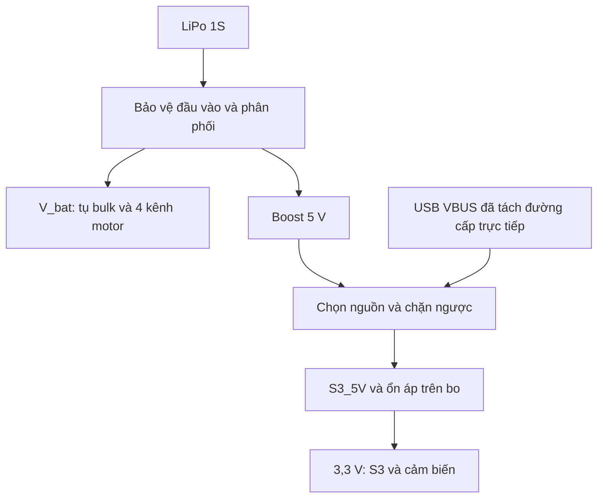

# UAV Mini Rev A — đặc tả nguồn và triển khai PCB
Cập nhật: 03/11/2026

**Trạng thái: đặc tả thiết kế; chưa có schematic/layout KiCad được kiểm chứng; chưa phát hành sản xuất.**
Không sử dụng tài liệu này như pinout đấu điện của SuperMini chưa xác định revision.

## 0. Giai đoạn hiện tại — chọn drone nền trước khi mua linh kiện

Ngày 03/11/2026, chủ dự án xác nhận chưa có phần cứng và muốn phát triển dựa trên một mẫu drone. Cấu hình S3 SuperMini + motor chổi than + LiPo 1S bên dưới là phương án tham khảo, chưa phải danh sách linh kiện đã sở hữu hoặc đã đặt mua.

### Hai cách bắt đầu
| Cách | Có thể kế thừa | Việc phải xác nhận |
|---|---|---|
| Theo một dự án mã nguồn mở | Firmware, sơ đồ tham khảo, khung và kinh nghiệm lắp | Đúng phiên bản linh kiện, giấy phép, khả năng tái lập và giới hạn tải |
| Mua drone làm nền | Khung, motor, cánh và có thể cả pin sau kiểm tra | Model, brushed/brushless, điện áp, tải, kích thước và khả năng thay bo |

Drone thương mại bay được không có nghĩa bo gốc cho phép nạp firmware tự viết. Nếu không có tài liệu/API/mã nguồn phù hợp, phương án dự kiến là dùng phần cơ khí–động lực và thay bộ điều khiển. Nếu mẫu chọn dùng brushless, phải đổi kiến trúc công suất sang ESC; bốn MOSFET low-side hiện tại không dùng để điều khiển trực tiếp motor brushless.

### Mẫu tham khảo đề xuất: Flix
[Flix của okalachev](https://github.com/okalachev/flix) có firmware, hướng dẫn lắp và file khung 3D. README được đọc ngày 03/11/2026 nêu hỗ trợ ESP32-S3, motor chổi than 8520 3,7 V, cánh 55/65 mm và LiPo 1S. Đây là căn cứ để khảo sát, chưa phải cấu hình đã chốt của UAV Mini. README Flix vẫn ghi PCB chính thức Flix2 đang phát triển; không coi đây là bộ PCB sản xuất đã sẵn sàng.

Đề xuất trình tự:
1. Xác định mẫu drone hoặc kit tham khảo và kiểm tra tài liệu.
2. Chốt tổ hợp khung–motor–cánh–pin và ngân sách khối lượng/lực nâng.
3. Chọn MCU/IMU, dựng bản thử nguồn và điều khiển tư thế.
4. Tích hợp PCB từ cấu hình đã xác minh.
5. Bổ sung ToF/optical flow để phát triển giữ độ cao/vị trí; có thể dự phòng cổng từ Rev A.

Link eBay do chủ dự án đề xuất: https://www.ebay.com/itm/920060294715 . Chưa truy xuất được nội dung để xác nhận model hoặc thông số; chưa đưa sản phẩm này vào BOM. Cần tên sản phẩm hoặc ảnh trang bán để đánh giá tiếp.

## 1. Phạm vi Rev A
PCB mẹ mang ESP32-S3 SuperMini, bốn kênh MOSFET low-side cho motor chổi than, đo pin và các cổng IMU/ToF/optical flow. Ưu tiên module boost 5 V để thử trước khi tích hợp IC nguồn. Chưa tích hợp sạc pin; dùng bộ sạc ngoài đúng loại pin. Số lớp, kích thước, độ dày và trọng lượng là yêu cầu chưa chốt.

## 2. Bằng chứng và giả định
| Nội dung | Trạng thái |
|---|---|
| README mô tả LiPo 1S, bốn motor, boost 5 V và ổn áp trên SuperMini | Đã đọc tài liệu; chưa đo phần cứng |
| ESP32-S3: nguồn đề xuất 3,3 V, năng lực nguồn tối thiểu 500 mA | Theo hướng dẫn Espressif; không phải dòng tiêu thụ cố định |
| Các miền nguồn chính ESP32-S3: 3,0–3,6 V | Theo hướng dẫn Espressif; phải xét thêm flash/PSRAM và cảm biến thực tế |
| Motor 8520 | Chỉ là mô tả trong README; chưa biết mã/điện áp/dòng/cánh |
| LiPo thường đầy 4,2 V | Giả định thiết kế; xác nhận pin không phải LiHV |
| SuperMini có LDO đủ tải và cách ly USB | Chưa xác nhận; không được dựa vào giả định này để cấp điện |
| GPIO/socket, connector cảm biến | Quy ước README; phải đối chiếu bo và module thật |

## 3. Lựa chọn kiến trúc
| Kiến trúc | Quyết định |
|---|---|
| 1S → boost 5 V → ổn áp bo → 3,3 V | Phương án thử Rev A, phụ thuộc kiểm tra nhiệt và USB |
| 1S → buck-boost 3,3 V → 3V3 | Phương án tối ưu sau; phải cách ly ổn áp bo và xử lý USB |
| 1S → LDO/buck 3,3 V | Có vùng dropout khi pin thấp, không ưu tiên toàn dải xả |
| 1S → boost 3,3 V | Không bảo đảm hạ áp khi pin đầy; không thay buck-boost |
| 1S → trực tiếp 3V3 | Cấm; pin đầy vượt dải nguồn |

Đây là sơ đồ chức năng, không phải schematic lắp điện. USB trên SuperMini có thể nối cứng VBUS với S3_5V: mux ngoài không bảo vệ được nếu còn đường nối đi vòng. Phải xác minh đường này và thiết kế ngắt/cách ly đúng vị trí. Không nối S3_5V với S3_3V3.

### Chính sách USB
- Rev A chỉ cho phép USB cấp logic, không cấp motor.
- Chọn nguồn bằng phần cứng: selector ngắt trước nối sau, hai diode OR-ing hoặc mux có chặn ngược. Kiểm tra mọi đường song song có sẵn trên SuperMini.
- Không coi EN hoặc load disconnect của boost là bảo đảm chặn ngược trong mọi trạng thái.
- Adapter USB ngắt VBUS chỉ là phương án debug sau khi xác nhận USB vẫn hoạt động.
- USB không được sạc pin qua đường boost. Mạch sạc, nếu bổ sung, cần thiết kế riêng.
- Kiểm tra cấp điện qua ADC VBAT_SENSE và GPIO khi một miền nguồn mất điện; có thể cần chia áp đóng cắt hoặc giải pháp khác theo datasheet.

## 4. Ngân sách dòng và nhiệt
I3V3_design = I_S3_peak + I_IMU_peak + I_ToF_peak + I_flow_peak + I_other.
Dùng đỉnh đồng thời hợp lý, tải bước, dung sai và dự phòng; dòng trung bình dùng để tính thời gian pin.

Ví dụ GIẢ ĐỊNH: 500 mA cho bo S3 + 100 mA cảm biến = 600 mA; thêm 25% dự phòng = 750 mA. Không phải kết quả đo UAV Mini.
Nếu LDO: P_loss ≈ (5 - 3,3) × I3V3. Tại 600 mA liên tục: 1,02 W, phải kiểm tra nhiệt bo.
I_bat_logic ≈ 5 × I5V / (eta_boost × Vbat_loaded).
Ví dụ I5V=0,6 A, eta=0,85, Vbat_loaded=3,2 V → khoảng 1,10 A.
I_bat_total ≈ tổng dòng bốn motor + I_bat_logic.

Đánh giá riêng bay ổn định, khởi động, tăng ga và lỗi kẹt motor. Không suy dòng motor đơn giản bằng duty nhân dòng stall.
Sụt áp ≈ I_total × (R_pin + R_dây + R_connector + R_đồng).
Tụ hỗ trợ quá độ: C ≥ delta_I × delta_t / delta_V; thêm sụt ESR ≈ delta_I × ESR.
MOSFET: P_cond ≈ I_rms² × RDS(on) tại nhiệt độ làm việc; xét thêm tổn hao chuyển mạch và khả năng GPIO nạp/xả Qg.
Diode: xét dòng hồi tiếp theo PWM và Vf, nhiệt, dòng xung, áp ngược.
Ngưỡng pin yếu phải căn cứ pin thật và điện áp dưới tải; đặt ngưỡng cảnh báo/dừng có hysteresis. UVLO rất thấp của IC boost không phải bảo vệ xả LiPo phù hợp.

## 5. Ứng viên nguồn — chưa duyệt BOM
| Mã | Vai trò | Giới hạn cần kiểm tra |
|---|---|---|
| TPS61023 | Boost 5 V | 3,7 A là giới hạn dòng công tắc; kiểm tra dòng đầu ra tại pin thấp, cuộn cảm, nhiệt |
| TPS63070 | Buck-boost đặt 3,3 V | Kiểm tra dòng ra, hiệu suất, dòng ngược và layout; không tự suy có chặn ngược |
| TPS63031 | Buck-boost 3,3 V | Hãng nêu tới 500 mA ở boost với điều kiện cụ thể; ít dự phòng khi cấp cả cảm biến |
| TPS2116 | Mux USB/boost | Dải 1,6–5,5 V, tối đa 2,5 A theo hãng; kiểm tra chuyển nguồn, nhiệt và cấu hình |

MOSFET, Schottky, tụ bulk, connector và module nguồn vẫn TBD. Chưa chọn footprint chỉ theo tên thương mại.

## 6. Dữ liệu đầu vào bắt buộc
| Hạng mục | Cần cung cấp/xác nhận |
|---|---|
| SuperMini | Ảnh hai mặt, link mua, revision, mã LDO, schematic USB/5V/3V3, khoảng cách hai hàng chân |
| Motor và cánh | Mã, điện áp, đường kính/cánh, dòng không tải/có cánh/khởi động/stall, lực nâng và khối lượng |
| Pin | Loại hóa học, dung lượng, C-rate, nội trở, đầu nối, bảo vệ và ngưỡng xả |
| Cảm biến | Mã module IMU/ToF/flow, schematic, nguồn/logic, dòng đỉnh, pull-up, IRQ/RESET |
| Cơ khí | Kích thước PCB, lỗ bắt vít, vị trí pin/motor, vùng anten và cửa nhìn cảm biến |
| Gia công | Số lớp, chiều dày, đồng, clearance/track/via của nhà máy |
| File hiện có | .kicad_pro, .kicad_sch, .kicad_pcb và thư viện custom nếu người dùng đã vẽ |

BOM mỗi dòng phải có: reference, giá trị, MPN, hãng, package, footprint, nguồn datasheet, điện áp/dòng/nhiệt tính toán, trạng thái xác minh. MOSFET cần RDS(on) bảo đảm ở VGS phù hợp 3,3 V, không chọn theo VGS(th).

## 7. Kế hoạch thực hiện và điều kiện hoàn thành
| Bước | Đầu ra | Điều kiện qua |
|---|---|---|
| 0 — Chọn nền tảng | Model/dự án tham khảo và cấu hình đề xuất | Xác nhận loại motor, pin, khung, firmware và cách kế thừa |
| A — Chốt yêu cầu | Bảng linh kiện/cơ khí và ngân sách dòng | Không còn dữ liệu mơ hồ ảnh hưởng pinout/nguồn |
| B — Thử nguồn trên bàn | Log điện áp/dòng/nhiệt/USB | Đủ dòng, không cấp ngược ngoài giới hạn, không brownout |
| C — Schematic | Project KiCad, PDF schematic, BOM | Mọi TBD quan trọng đã chốt, pinout khớp, ERC được review |
| D — Footprint/layout | PCB, net classes, 3D | In 1:1 khớp bo/module, dòng/nhiệt phù hợp, keepout đúng |
| E — Review sản xuất | Gerber, drill, BOM, vị trí linh kiện nếu lắp máy | Không còn net chưa route; DRC được review, kiểm tra Gerber độc lập |
| F — Bring-up PCB | Log thử nghiệm Rev A | Nguồn, motor, sensor, reset/failsafe đạt tiêu chí |
| G — Kiểm chứng bay | Log điều khiển/ước lượng | Đánh giá riêng; PCB đạt DRC không chứng minh bay được |

Đặt test point V_bat, BOOST_5V, S3_5V, S3_3V3, GND và tín hiệu cần đo. Dự kiến chỗ đo dòng logic và ngắt nguồn motor khi debug. Giữ đường hồi motor tránh vùng MCU/IMU, mặt phẳng GND liên tục, vòng chuyển mạch nhỏ. Không chọn bề rộng track cố định trước khi biết dòng và stackup.

## 8. Ma trận thử nghiệm
Tháo cánh khi thử ban đầu; thử tải có cánh trên gá bảo vệ.
| Thử | Dữ liệu | Tiêu chí |
|---|---|---|
| Nguồn không tải và tải bước | Vbat, 5V, 3V3, overshoot/dip | Trong giới hạn mọi linh kiện, không reset |
| Dải pin | Khởi động và chạy tại pin đầy đến ngưỡng dừng | Không mất điều áp trước điểm thiết kế |
| Wi-Fi/BLE và sensor đồng thời | Xung dòng, reset, lỗi bus | Không brownout/mất mẫu ngoài ngân sách |
| Từng motor rồi bốn motor | Dòng, nhiễu, step PWM | Nguồn và linh kiện trong giới hạn |
| USB riêng/pin riêng/cả hai | Dòng về VBUS, boost, pin; cả thứ tự cắm/rút | Không cấp ngược ngoài giới hạn datasheet; USB không cấp motor |
| Nhiệt liên tục | LDO, boost, cuộn cảm, MOSFET, diode, connector | Dư giới hạn nhiệt theo datasheet và môi trường dự kiến |
| Reset/nạp/mất liên lạc | Gate và motor | Motor mặc định tắt, failsafe hoạt động |
| Mất nguồn logic còn pin | ADC/GPIO và dòng rò | Không phantom-power vượt giới hạn |
| Pin yếu | Cảnh báo/dừng/hysteresis | Đúng giới hạn pin và khả năng duy trì điều khiển |

Đo oscilloscope sát tải với mass ngắn. Ghi instrument, firmware, linh kiện, nhiệt độ môi trường, waveform và pass/fail. Chưa có phép thử nào trong bảng được ghi nhận đã chạy.

## 9. Tài liệu gốc
- [Espressif — ESP32-S3 schematic checklist](https://docs.espressif.com/projects/esp-hardware-design-guidelines/en/latest/esp32s3/schematic-checklist.html)
- [TI TPS61023](https://www.ti.com/product/TPS61023)
- [TI TPS63070](https://www.ti.com/product/TPS63070)
- [TI TPS63031](https://www.ti.com/product/TPS63031)
- [TI TPS2116](https://www.ti.com/product/TPS2116)
- [KiCad documentation](https://docs.kicad.org/)

Thông số IC không chứng nhận chất lượng một module mua ngoài. Chưa có schematic đúng SuperMini để xác minh tương thích.
