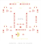

# UAV Mini Rev A — project KiCad DRAFT-0

Ngày 03/11/2026. **Đã có file schematic và PCB chỉnh sửa được. Đây là bản thiết kế điện và bố trí thử, chưa đi dây, chưa dùng để gia công hoặc cấp điện.**

## Mở trên máy Windows

1. Tải [ZIP của repository](https://github.com/hoangnguyen123cp5-glitch/uav_mini/archive/refs/heads/main.zip), chọn **Extract All**. Không mở file trực tiếp trong ZIP.
2. Trong KiCad 7 trở lên, chọn **File → Open Existing Project** rồi mở `hardware/kicad/UAV_Mini_RevA_Draft/UAV_Mini_RevA_Draft.kicad_pro`.
3. Mở `.kicad_sch` để xem sơ đồ; mở `.kicad_pcb` để xem bố trí và các đường nối chưa định tuyến (ratsnest).
4. Giữ nguyên `fp-lib-table` và thư mục `footprints` cùng project. Symbol được nhúng trong schematic; footprint dùng trong bản này có bản sao đi kèm.
5. Lưu bản sao trước khi sửa bằng phiên bản KiCad mới hơn. Phiên bản đã dùng để kiểm tra: **7.0.11**; chưa thử mở trên Windows hoặc các phiên bản khác.

Project được tạo trong môi trường làm việc của trợ lý rồi đưa vào repository; chưa có thao tác cài đặt hay sửa file trên máy của chủ dự án.

## File đã có

| File | Nội dung |
|---|---|
| `UAV_Mini_RevA_Draft.kicad_pro` | Project KiCad |
| `UAV_Mini_RevA_Draft.kicad_sch` | 33 symbol, bốn kênh motor, socket S3, cổng cảm biến, chia áp pin |
| `UAV_Mini_RevA_Draft.kicad_pcb` | 33 footprint, hai lớp đồng, biên 60 × 60 mm giả định; chưa có track/zone |
| `design.net.xml` | Netlist xuất bằng KiCad, dùng đối chiếu pad |
| `design_manifest.json` | Bảng chân và vị trí đề xuất; không phải BOM để đặt mua |
| `validation.json`, `drc-draft.txt` | Kết quả kiểm tra và lỗi chưa đi dây |
| `preview/` | SVG xuất trực tiếp từ KiCad |



[Xem toàn bộ schematic](preview/UAV_Mini_RevA_Draft.svg).

## Đã kiểm tra và chưa kiểm tra

- KiCad đọc được schematic, xuất SVG và netlist; `pcbnew` đọc lại được PCB đã lưu.
- Các chân có net trong schematic khớp bảng thiết kế và pad PCB. Đã đối chiếu riêng gate/source/drain, chiều diode và ba net nguồn tách biệt.
- DRC của bố trí hiện tại: **0 vi phạm khác, 67 mục kết nối chưa hoàn thành**, 0 lỗi footprint. **Không phải DRC đạt toàn bộ.** Quy tắc mặc định dùng cho kiểm tra này chưa thay thế thông số nhà máy và ngân sách dòng điện.
- Chưa chạy ERC; chưa đo phần cứng, thử nhiệt, tải xung, USB, motor hoặc bay. ERC sau này cũng không chứng minh nguồn đủ dòng hoặc pinout module đúng.
- Chưa có Gerber, BOM mua hàng, pick-and-place, lỗ bắt vít, keepout anten được xác nhận hoặc phê duyệt sản xuất.

## Các quyết định có chủ ý

**Nguồn còn hở:** `BOOST_5V` ở J11.3 chưa nối vào `S3_5V` ở J8.1. Vì chưa biết mạch VBUS của SuperMini, chưa có mạch chọn nguồn/cách ly USB hoàn chỉnh. Không hàn dây nối tắt khoảng hở này. `S3_5V` và `S3_3V3` là hai net riêng. J11 chỉ là quy ước giao tiếp module, không mô phỏng một module boost cụ thể.

**Chia áp ADC:** R9/R10 dự kiến 10 kΩ/10 kΩ, C3 dự kiến 100 nF. JP1 là cầu hàn **mặc định mở**, tách `VBAT_DIV` và `VBAT_SENSE`; chỉ xem xét đóng sau khi kiểm tra dòng tiêm ADC lúc S3 mất nguồn. Firmware bench vẫn tắt đo pin.

**Chân MOSFET:** bản CAD dùng `Q_NMOS_GSD`: **1=G, 2=S, 3=D**, footprint SOT-23 tạm. Bài học cũ ở README dùng `Q_NMOS_GDS` có thứ tự khác. Không lấy số chân trong bài cũ để lắp bản này. Cần đối chiếu datasheet mã MOSFET thực tế trước khi chốt.

**Diode:** pin 1=K nối V_bat, pin 2=A nối cực âm motor. SOD-123 là kích thước thử, không phải linh kiện đã đáp ứng dòng hoặc nhiệt.

**Cơ khí:** bo 60 × 60 mm và khoảng cách hai hàng socket 17,78 mm chỉ để khảo sát bố trí; chưa khớp SuperMini hoặc khung cụ thể. Độ dày 1,6 mm mặc định của KiCad chưa được chọn cho sản phẩm. Footprint header 2,54 mm, điện trở/tụ 0603 và tụ bulk radial 6,3 mm đều là giả định; không có chứng nhận dòng motor cho các đầu nối này.

**Cảm biến:** J6/J9/J10 dành cho module hoàn chỉnh có giao tiếp phù hợp 3,3 V, không dành cho IC cảm biến trần. Chưa chốt module nào, mạch ổn áp riêng, pull-up I²C, tụ lọc hay định hướng IMU. Chưa kiểm tra khả năng cấp dòng của S3_3V3. ADC và linh kiện dưới module S3 cần kiểm tra khoảng hở chiều cao.

## Cần chốt để tiếp tục định tuyến và làm PCB thử

| Hạng mục | Dữ liệu cần có | Ảnh hưởng thiết kế |
|---|---|---|
| SuperMini | Link nhà sản xuất, revision, sơ đồ nguồn, ảnh hai mặt, kích thước và khoảng cách chân | Socket, USB, nguồn logic, vùng anten |
| Motor/cánh/khung | Mã motor brushed, điện áp, dòng không tải/có cánh/khởi động/kẹt trục, đường cong lực nâng; cánh CW/CCW; bản vẽ khung | MOSFET, diode, bề rộng đồng, đầu nối, khối lượng và lỗ bắt |
| Pin | Mã pin 1S, điện áp sạc, dung lượng, dòng xả, đầu nối/cực tính, điện trở trong | Phân phối nguồn, sụt áp, bảo vệ và ngưỡng dừng |
| Q1–Q4 | Mã đặt hàng và datasheet; RDS(on) được đặc tả ở VGS phù hợp 3,3 V, SOA, điện tích gate, nhiệt | Pinout, package, tổn hao; không chọn chỉ theo VGS(th) |
| D1–D4 | Mã diode, VRRM, dòng trung bình/xung, VF, nhiệt | Package và khả năng chịu xung hồi tiếp |
| C1 | Điện dung, điện áp, ESR, ripple, kích thước/khối lượng | Sụt áp xung và bố trí vòng dòng motor |
| Boost/USB | Mã module/IC, dòng ở Vin thấp nhất, hiệu suất, startup, reverse-current behavior; đường VBUS của bo | Thiết kế nguồn còn thiếu; kiểm tra cả USB-only, battery-only và hai nguồn |
| IMU/ToF/flow | Mã module, sơ đồ, điện áp, dòng, pinout, mức logic và kích thước | Đầu nối và rail cảm biến |

Sau khi có dữ liệu: hoàn thiện mạch nguồn/bảo vệ, kiểm tra footprint 1:1 → ERC → định tuyến và plane GND theo dòng thực → DRC theo nhà máy → review → đặt ít PCB thử → kiểm tra nguồn giới hạn dòng, USB backfeed, ripple, nhiệt và motor trước thử bay.

## Tái tạo và kiểm tra bằng mã

Các file CAD đã lưu sẵn; người dùng Windows **không cần chạy Python** để mở/sửa bằng KiCad.

Người bảo trì dùng Python có module `pcbnew` và KiCad CLI:

```bash
python3 tools/verify_kicad_draft.py --cli kicad-cli
# Chỉ dùng sau khi đã lưu riêng mọi sửa tay; lệnh sau ghi đè CAD:
python3 tools/generate_kicad_draft.py --kicad-share /usr/share/kicad --overwrite
```

Generator không chạy các bước xuất preview/netlist hoặc kiểm tra thay cho `verify_kicad_draft.py`. Khi sửa CAD bằng tay, đó là nguồn làm việc mới; không chạy generator để ghi đè sửa tay. Sau khi đi dây, cập nhật trạng thái và bộ kiểm tra vốn đang yêu cầu đúng bản chưa đi dây.

Symbol nhúng và các footprint sao chép nguyên bản từ thư viện KiCad 7.0.11 (Ubuntu), KiCad Community; xem `KICAD_SYMBOLS_COPYRIGHT.txt` và `KICAD_FOOTPRINTS_COPYRIGHT.txt` (CC BY-SA 4.0 kèm ngoại lệ cho thiết kế điện tử). Chưa bao gồm model 3D; việc chọn footprint tạm không xác nhận linh kiện sẽ lắp vừa.
